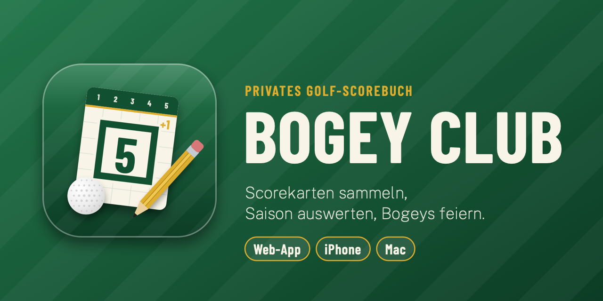

# Bogey Club



Privates Golf-Scorebuch: Scorekarten erfassen (Foto, PDF oder TAG-Heuer-Link), mehrere Spieler über viele Runden verfolgen und daraus Jahresstatistik, Ranking, Badges und Platz-Briefings erstellen.

## Inhalt

| Ordner | Was |
|---|---|
| `web/` | Web-App als eine HTML-Datei (läuft als Claude-Artefakt mit Datenbank, Downloads, Bild-Upload). `index.html` + Logo. |
| `mac/` | Mac-App: dieselbe Oberfläche wie `web/`, aber ohne Claude – Daten auf dem Mac, Scorekarten-Erkennung offline mit Apple Vision. |
| `BogeyScan/` | Gemeinsame Scorekarten-Erkennung für iPhone- und Mac-App (Swift-Paket): Apple Vision liest den Text auf dem Gerät, danach werden Lochnummern als Spaltenraster genutzt, leere Zellen nachgelesen und Par, Lochvorgaben und Spielerzeilen erkannt. Tests: `cd BogeyScan && swift test`. |
| `windows/` | Windows-App (Electron): dieselbe Oberfläche, Daten auf dem PC, Scorekarten-Erkennung offline mit mitgelieferter Texterkennung (Tesseract). |
| `ios/GolfScorebuch/` | iOS-App in SwiftUI + SwiftData, Scorekarten-Erkennung offline mit Apple Vision (über `BogeyScan`). In Xcode öffnen: `GolfScorebuch.xcodeproj`. |
| `osm/` | Platzkarten aus OpenStreetMap: `fetch.sh` lädt die Rohdaten über Overpass, `osm2map.py` wandelt sie in kompakte Karten-JSON um, `render.js` zeichnet sie als SVG. |
| `server/` | Cloudflare Worker (`worker.js`: API, Bilder, Zugangsprüfung), `runtime.js`, das im Browser die Claude-Laufzeit (Datenbank, Bilder, Downloads, Scorekarte lesen) ersetzt, und `ocr.js` – die Scorekarten-Erkennung im Browser. |
| `public/` | Von `build.mjs` erzeugt: die ausgelieferte Web-App. Nicht von Hand ändern. |
| `docs/` | Website für GitHub Pages mit eigenem Jekyll-Theme (Farben, Schriften und Logo der App): Startseite, Funktionen, Downloads, Anleitung. Einschalten unter Settings → Pages → Branch `main`, Ordner `/docs`. |
| `design/` | Frühere Icon-Entwürfe und das GitHub-Vorschaubild `social-card.png` (gezeichnet von `make-social-card.swift`; hochladen unter Settings → General → Social preview). |

## Golf-Logik (WHS / DGV)

- Spielvorgabe = round(HI · Slope / 113 + CR − Par); 9-Loch-Plätze mit halbem Index
- Stableford = max(0, 2 + Par + Vorgabeschläge − Schläge)
- Score-Differential mit Netto-Doppelbogey als Lochmaximum, virtuelles Handicap nach WHS-Tabelle (beste n der letzten 20), 9-Loch-Runden mit erwartetem Ergebnis für die zweite Hälfte (0,52 · HI + 1,2)
- Striche zählen im Brutto als Netto-Doppelbogey (Par + 2 + Vorgabeschläge)

## Platzkarten neu erzeugen

```bash
cd osm
./fetch.sh bruchsal Bruchsal                         # → bruchsal.json
python3 osm2map.py bruchsal.json bruchsal.map.json Bruchsal
```

Die Karte wird in der Web-App in der Datenbank-Collection `coursemaps` gespeichert (Dokument-ID = Teil der Platz-ID vor dem ersten „-“, oder die volle Platz-ID für Sonderfälle), Feld `json` mit dem Inhalt der `.map.json`. Kartendaten © OpenStreetMap-Mitwirkende, ODbL.

## Daten

Runden, Spieler und Plätze liegen nicht im Repo. Sicherung über die Web-App: Reiter **Spieler → Daten-Backup**.

## Mac-App (ohne Claude)

Die Mac-App zeigt `web/index.html` in einem eigenen Fenster und ersetzt die Claude-Laufzeit durch den Mac selbst (`mac/runtime.js` ↔ Swift):

- **Daten:** `~/Library/Application Support/Bogey Club/daten.json` (Spieler, Plätze, Runden, Platzkarten), Bilder im Unterordner `Bilder`, einmal täglich eine Kopie unter `Sicherungen` (die letzten 30). Menü **Bogey Club → Datenordner im Finder zeigen**.
- **Scorekarte einlesen:** Foto oder PDF wird mit der Texterkennung von macOS gelesen (offline). Lochnummern-Zeile dient als Spaltenraster, leere Zellen werden einzeln nachgelesen. Gedruckte Karten klappen gut, Handschrift weniger – Werte danach in der Karte prüfen.
- **Speichern:** PDFs, Rundenkarten und Backups über den normalen „Sichern unter“-Dialog.
- **Offline:** Schriften, jsPDF und pdf.js liegen in `mac/vendor/` (neu laden mit `node mac/fetch-vendor.mjs`). Nur die Links zu Apple Karten / Google Maps brauchen Internet.

Bauen (Xcode muss installiert sein):

```bash
npm run mac          # oder ./mac/build.sh  → mac/build/Bogey Club.app
cd mac && swift test # Tests für Datenablage und Scorekarten-Erkennung
```

Das Programm-Icon (Scorekarte mit Bogey-Kästchen, Bleistift, Golfball; Club-Farben, Schrift Barlow Condensed) zeichnet `mac/icon/make-icon.swift` für alle Plattformen: Mac (`mac/AppIcon.icns`), iPhone (`AppIcon.appiconset/icon.png`) , Web-App (`server/icons/`) und das Logo im App-Kopf und in den PDFs (`web/bogey-club-logo.png`). Neu erzeugen: `swift mac/icon/make-icon.swift && iconutil -c icns mac/build/AppIcon.iconset -o mac/AppIcon.icns`, danach `npm run build` und `npm run mac`.

Die App danach in den Ordner „Programme“ ziehen. Sie ist nur lokal signiert; beim ersten Öffnen auf einem anderen Mac per Rechtsklick → „Öffnen“ starten.

Umzug der Daten: in der Claude- oder Cloudflare-Version **Spieler → Daten-Backup → Backup herunterladen**, in der Mac-App **Backup einspielen**.

## Hosting auf Cloudflare

Die Web-App läuft als ein Cloudflare Worker (`wrangler.jsonc`):

- **App:** `web/index.html` wird von `build.mjs` nach `public/` gebaut (mit `runtime.js`, App-Icon und Manifest für „Zum Home-Bildschirm“).
- **Daten:** D1-Datenbank `bogeyclub` (Tabelle `docs`, eine Zeile je Spieler/Platz/Runde/Platzkarte; wird automatisch angelegt).
- **Bilder:** R2-Bucket `bogeyclub-photos`, ausgeliefert unter `/_blob/<id>`.
- **Zugang:** Cloudflare Access. Der Worker prüft bei jeder Anfrage das Access-Token gegen `ACCESS_TEAM` und `ACCESS_AUD`; sind die leer, bleibt die App geschlossen.
- **Deploy:** Workers Builds, verbunden mit diesem Repo – jeder Push auf `main` wird veröffentlicht.

## Windows-App (ohne Claude)

Gleicher Aufbau wie die Mac-App: `web/index.html` in einem eigenen Fenster, `mac/runtime.js` als Brücke (unter Windows über `windows/preload.js`), Datenablage in `windows/store.js` im selben Format wie auf dem Mac.

- **Daten:** `%APPDATA%\Bogey Club\daten.json`, Bilder unter `Bilder`, tägliche Kopien unter `Sicherungen`. Menü **Datei → Datenordner öffnen**.
- **Scorekarte einlesen:** `server/ocr.js` mit Tesseract, komplett in der App enthalten (kein Internet nötig).
- **Umzug:** wie beim Mac über **Spieler → Daten-Backup**.

Bauen (auf Mac oder Windows, Node nötig):

```bash
npm run windows      # → windows/dist/Bogey-Club-1.0.0-portable.zip (darin „Bogey Club.exe“)
cd windows && npm test
```

Die ZIP-Datei auf dem PC entpacken und „Bogey Club.exe“ starten (Windows fragt beim ersten Start evtl. nach, weil die App nicht signiert ist: „Weitere Informationen → Trotzdem ausführen“). Ein Installationsprogramm mit Startmenü-Eintrag lässt sich nur unter Windows (oder auf Intel-Macs) bauen: `cd windows && npm run dist:installer`.

## Texterkennung auf allen Plattformen

| Wo | Womit | Offline |
|---|---|---|
| iPhone-App | Apple Vision über `BogeyScan` | ja |
| Mac-App | Apple Vision über `BogeyScan` | ja |
| Windows-App | Tesseract.js in `server/ocr.js`, mitgeliefert | ja |
| Web-App in Claude | Claude (KI) | nein |
| Web-App gehostet (Browser) | Tesseract.js in `server/ocr.js` – Apples Vision gibt es im Browser nicht | Bild bleibt im Browser; das Erkennungsmodul (~5 MB) lädt beim ersten Mal von jsDelivr |

`server/ocr.js` ist eine Übertragung von `BogeyScan/Sources/BogeyScan/ScorecardParser.swift` nach JavaScript – Änderungen an der Auswertung bitte in beiden Dateien machen. Handschrift liest Tesseract deutlich schlechter als Apple Vision.

Lokal testen:

```bash
npm install
printf 'DEV_USER=ich@example.com\nACCESS_TEAM=dev\nACCESS_AUD=dev\n' > .dev.vars   # nur lokal: überspringt Access auf localhost
npx wrangler dev
```

Umzug der Daten aus der Claude-Version: dort **Spieler → Daten-Backup → Backup herunterladen** (enthält auch die Bilder), in der gehosteten App **Backup einspielen**.
